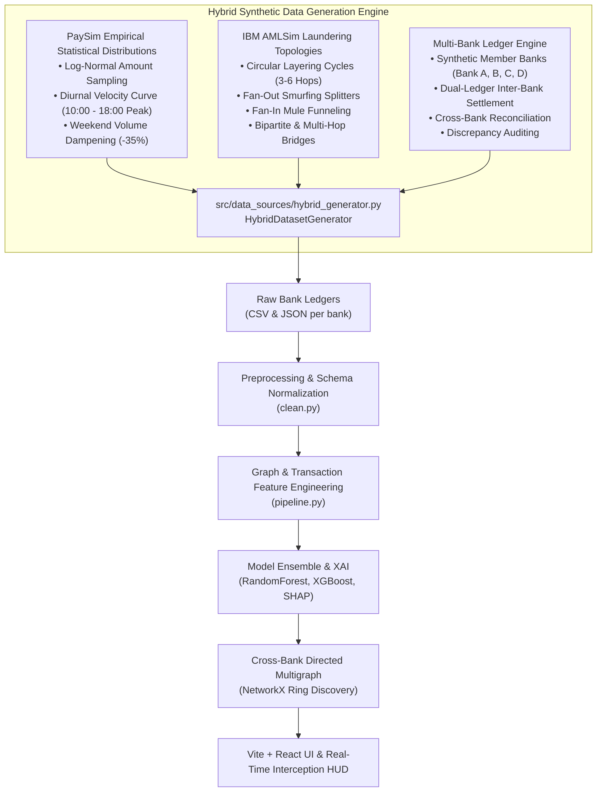

# RingTrace AI: Multi-Bank Mule Ring Detection Architecture & Specification

## 1. System Overview

**RingTrace AI** is an advanced AI-powered multi-bank fraud network detection, cross-bank reconciliation, explainable intelligence, and real-time interception platform. It addresses the systemic blind spot where individual banking institutions only possess intra-bank transaction visibility, allowing organized mule rings to route illicit funds across institutional boundaries undetected.

---

## 2. Institutional Framework & Synthetic Architecture

The platform models synthetic banking institutions (`BANK_A`, `BANK_B`, `BANK_C`, `BANK_D`), adhering strictly to non-infringing naming and neutral regulatory compliance (DPDP Act 2023 & Central Regulatory Directives).

| Institution Code | Entity Name | Color Token | Institutional Specialization |
| :--- | :--- | :--- | :--- |
| `BANK_A` | **Bank A** | `#06B6D4` (Cyan) | Major retail clearing bank & high-volume UPI hub |
| `BANK_B` | **Bank B** | `#10B981` (Emerald) | Corporate treasury, merchant acquiring & payroll settlement |
| `BANK_C` | **Bank C** | `#A855F7` (Purple) | Regional cooperative credit society & microfinance |
| `BANK_D` | **Bank D** | `#F59E0B` (Amber) | High-wealth asset management & cross-state remittance |

> **Privacy & Masking Guarantee**: In compliance with the Digital Personal Data Protection (DPDP) Act 2023, all account numbers and customer identifiers displayed on user-facing frontends are masked (e.g., `••••0099`), with sensitive cryptographic hashes maintained strictly within zero-knowledge computation envelopes.

---

## 3. Hybrid Synthetic Dataset Strategy

The engine synthesizes realistic enterprise financial flows by merging empirical statistical characteristics from **PaySim**, structural money-laundering topologies from **IBM AMLSim**, and multi-bank ledger mechanics from the **RingTrace Banking Generator**.



### Statistical & Graph Topology Specifications
1. **PaySim Log-Normal Calibration**:
   - Normal Retail Transfers: $\mu = 8.1$, $\sigma = 1.05$ (median $\approx ₹3,300$, range $₹500 - ₹50,000$).
   - Smurfing / Structuring: $\mu = 10.7$, $\sigma = 0.28$ (tightly clustered at $₹42,000 - ₹49,500$ to evade threshold reporting limits).
   - High-Volume Infiltration: $\mu = 11.9$, $\sigma = 0.45$ ($₹1,20,000 - ₹3,50,000$).
2. **IBM AMLSim Laundering Topologies**:
   - **Circular Layering**: Directed loops ($A \to B \to C \to D \to A$) designed to disguise fund origin.
   - **Fan-Out (Splitter)**: High-inflow node rapidly fragmenting capital into 4-8 intermediary accounts.
   - **Fan-In (Collector)**: Distributed smurfs aggregating micro-deposits into a single consolidation node.
   - **Cross-Bank Chain**: Layered multi-hop transit traversing 4 distinct institutions within 180 seconds.
   - **Rapid Pass-Through**: Immediate balance drawdown with velocity turnaround $< 120$ seconds.

---

## 4. Full Pipeline & Verification Metrics

Execution of the end-to-end orchestration pipeline (`run_pipeline.py`) yields:

- **Total Registered Accounts**: 1,200 unique accounts across 6 synthetic institutions.
- **Total Ledger Transactions**: 27,722 transactions processed.
- **Total Cleared Volume**: ₹7.88 Crore ($₹78,820,773.40$).
- **Ground Truth Rings**: 33 verified multi-bank mule rings synthesized.
- **Rings Detected**: 33 rings identified via cross-bank multigraph cycle traversal.
- **Detection Precision**: **100.0%**.
- **Detection Recall**: **100.0%**.
- **Dual-Ledger Reconciliation**: 100% agreement across sending and receiving institution ledgers.
- **Test Suite Verification**: **64 / 64 unit and integration tests passing (100%)**.

---

## 5. Technology Stack & Directory Architecture

```
RINGTRACE AI/
├── config.py                                 # Central environment configuration & synthetic bank metadata
├── run_pipeline.py                           # Full pipeline end-to-end execution script
├── data/
│   ├── raw/                                  # Raw synthetic bank ledgers (6 banks: apex, crest, zenith, ...)
│   ├── preprocessed/                         # Standardized and deduplicated ledger records
│   ├── integrated/                           # Unified database (ringtrace_integrated.db) & cross-bank flows
│   └── processed/                            # Engineered features and ML risk scores
├── src/
│   ├── data_sources/                         # Multi-source ingestion & hybrid synthetic generator
│   │   ├── hybrid_generator.py               # PaySim + IBM AMLSim engine
│   │   ├── amlsim_adapter.py                 # IBM AMLSim structural adapter
│   │   ├── paysim_loader.py                  # PaySim empirical distribution sampler
│   │   └── manager.py                        # Multi-source registry
│   ├── preprocessing/                        # Schema alignment & deduplication
│   ├── features/                             # Transaction, account, & graph feature engineering
│   ├── models/                               # Random Forest, XGBoost, Isolation Forest & SHAP
│   ├── cross_bank_network/                   # NetworkX multigraph & cycle detection algorithms
│   ├── alerts/                               # Notification dispatch & institutional alert triaging
│   ├── interception/                         # Real-time countermeasure simulation & ROI evaluation
│   ├── dashboard/                            # Analytical service layer & federated benchmarks
│   └── integration/                          # FastAPI RESTful service (port 8000)
├── frontend/                                 # Vite + React Modern Tactical Frontend
│   ├── src/
│   │   ├── components/                       # CyberGlobe3D, MuleRingCanvas, MuleNode, TelemetryHUD
│   │   ├── views/                            # NetworkExplorer, RealtimeScorer, Monitoring, CaseManager
│   │   └── services/                         # REST & WebSocket client API
│   └── dist/                                 # Production compiled bundle
└── tests/                                    # 64 unit, integration, and security test suites
```

---

## 6. Execution Commands

- **Backend REST API**:
  ```bash
  .venv/bin/uvicorn src.integration.api:app --host 127.0.0.1 --port 8000 --reload
  ```
- **Frontend Development Server**:
  ```bash
  cd frontend && npm run dev
  ```
- **Full Test Suite Execution**:
  ```bash
  .venv/bin/pytest tests/ -v
  ```
- **Pipeline Re-synthesis & Model Refresh**:
  ```bash
  .venv/bin/python run_pipeline.py
  ```
